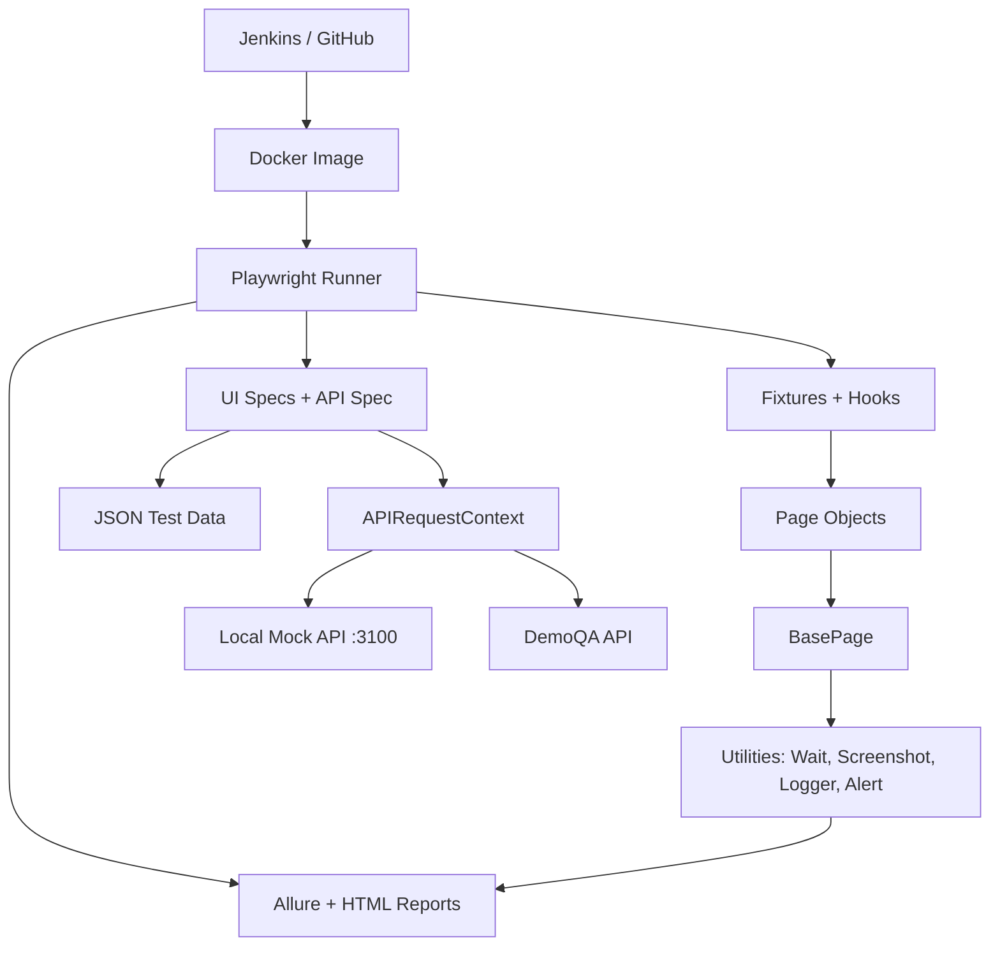

# adactin-playwright-automation

A complete Playwright (JavaScript) automation framework for the **Adactin Hotel App** (`https://adactinhotelapp.com/`). It covers UI automation, REST API automation, data-driven testing, hooks, utilities, logging, screenshots, Allure reporting and a Docker + Jenkins CI/CD pipeline.

**Repository name:** `adactin-playwright-automation`

**Repository description:** `Playwright (JavaScript) automation framework for Adactin Hotel App with POM, JSON data-driven testing, hooks/fixtures, Allure reporting, screenshots and REST API tests — 30 positive/negative test cases.`

---

## Table of contents

1. [What this project does](#what-this-project-does)
2. [Framework features](#framework-features)
3. [Project structure](#project-structure)
4. [Prerequisites](#prerequisites)
5. [Local setup](#local-setup)
6. [Running tests](#running-tests)
7. [Test data](#test-data)
8. [Mock API](#mock-api)
9. [Test coverage](#test-coverage)
10. [Architecture](#architecture)
11. [Hooks and utilities](#hooks-and-utilities)
12. [Reports, screenshots and logs](#reports-screenshots-and-logs)
13. [Docker](#docker)
14. [Jenkins CI/CD](#jenkins-cicd)
15. [Publishing to GitHub](#publishing-to-github)
16. [Troubleshooting](#troubleshooting)

---

## What this project does

- Automates the full Adactin booking flow: login → search hotel → select hotel → book hotel → confirmation → booked itinerary.
- Verifies positive and negative scenarios on every page.
- Tests REST APIs with Playwright's built-in `request` fixture: GET, POST, PUT and DELETE.
- Validates status codes, response headers, JSON schema and response time.
- Reads credentials, endpoints and expected results from JSON files.
- Generates Allure and HTML reports with step screenshots, failure screenshots and execution logs.
- Runs the same suite inside a Docker container through a Jenkins declarative pipeline.

---

## Framework features

| Feature | Implementation |
| --- | --- |
| Page Object Model | One class per page under `pages/` |
| Data-driven testing | `testdata/loginData.json`, `testdata/apiData.json` |
| Fixtures | `pageSetup` and `loggedInPage` in `fixtures/testSetup.js` |
| Hooks | `beforeAll`, `beforeEach`, `afterEach`, `afterAll`, `globalSetup`, `globalTeardown` |
| Reusable utilities | Wait, screenshot, logger, alert/popup, API validation, booking flow |
| API automation | `request` fixture + local mock server + DemoQA |
| Reporting | Allure + Playwright HTML |
| CI/CD | `Dockerfile` + `Jenkinsfile` |

---

## Project structure

```
adactin-playwright-automation/
├── Dockerfile
├── Jenkinsfile
├── playwright.config.js
├── package.json
├── package-lock.json
├── .gitignore
├── .dockerignore
├── README.md
├── docs/
│   ├── ARCHITECTURE.md
│   └── JENKINS.md
├── hooks/
│   ├── globalSetup.js
│   └── globalTeardown.js
├── fixtures/
│   └── testSetup.js
├── pages/
│   ├── BasePage.js
│   ├── LoginPage.js
│   ├── SearchHotelPage.js
│   ├── SelectHotelPage.js
│   ├── BookHotelPage.js
│   ├── BookingConfirmationPage.js
│   ├── BookedItineraryPage.js
│   └── ChangePasswordPage.js
├── tests/
│   ├── api.spec.js
│   ├── login.spec.js
│   ├── searchHotel.spec.js
│   ├── selectHotel.spec.js
│   ├── bookHotel.spec.js
│   ├── bookingConfirmation.spec.js
│   ├── bookedItinerary.spec.js
│   ├── changePassword.spec.js
│   └── logout.spec.js
├── utilities/
│   ├── screenshot.js
│   ├── wait.js
│   ├── logger.js
│   ├── alert.js
│   ├── apiValidation.js
│   └── bookingFlow.js
├── testdata/
│   ├── loginData.json
│   └── apiData.json
└── mock/
    └── server.js
```

Generated folders such as `allure-results/`, `allure-report/`, `playwright-report/`, `test-results/` and `logs/` are created only when tests run. They are ignored by Git and are not committed.

---

## Prerequisites

- **Node.js 18+** and npm
- Playwright browsers (installed once during setup)
- Internet access for `https://adactinhotelapp.com/` and `https://demoqa.com`
- **Docker** (only for containerized runs)
- **Jenkins** with Git, Docker and Allure plugins (only for CI/CD)

Check your versions:

```
node --version
npm --version
```

---

## Local setup

```
git clone https://github.com/Gotam-Dulhani/adactin-playwright-automation.git
cd adactin-playwright-automation
npm install
npx playwright install chromium firefox webkit
```

If you already have the folder, skip the clone and just run `npm install`.

---

## Running tests

Run everything in one browser:

```
npx playwright test --project=chromium
npx playwright test --project=firefox
```

Run only the API suite:

```
npm run test:api
```

Open Playwright UI mode:

```
npm run test:ui
```

Useful package scripts:

| Command | Purpose |
| --- | --- |
| `npm test` | Run all tests in all configured projects |
| `npm run test:chromium` | Run all tests in Chromium |
| `npm run test:firefox` | Run all tests in Firefox |
| `npm run test:api` | Run only API tests |
| `npm run mock:api` | Start the mock API manually |
| `npm run allure:generate` | Generate the Allure HTML report |
| `npm run allure:open` | Open the generated Allure report |

> Run **one project at a time**. Do not type an extra word such as `ya` between commands.

---

## Test data

### `testdata/loginData.json`

Contains the two supplied Adactin credentials used by the data-driven login tests and fixtures:

```json
{
  "validUsers": [
    { "username": "mufeezhanif", "password": "Hello0009" },
    { "username": "testerharis01", "password": "testerharis01" }
  ]
}
```

### `testdata/apiData.json`

Stores API base URLs, endpoint paths, expected status codes, expected book title, password suffix, JSON schema fields and maximum response times. Nothing API-related is hard-coded in `tests/api.spec.js`.

---

## Mock API

The original PDF host `api-testing-postman.vercel.app` currently returns `500/404/403`. To keep the exact PDF endpoint paths while making the suite deterministic, a tiny local mock server is included.

- File: `mock/server.js`
- Base URL: `http://127.0.0.1:3100`
- `POST /api/v1/auth/login` → returns a bearer token
- `GET /api/v1/users/current-user` → returns the current user when the bearer token is valid
- `GET /health` → used by Playwright's `webServer` health check

Playwright starts and stops this server automatically through `playwright.config.js`. To run it manually:

```
npm run mock:api
```

The remaining API tests use DemoQA:

- `GET /BookStore/v1/Books`
- `POST /Account/v1/User`
- `PUT /Account/v1/User/test`
- `POST /Account/v1/GenerateToken`
- `DELETE /Account/v1/User/{userID}`

---

## Test coverage

30 test cases, positive and negative:

| Area | Tests |
| --- | --- |
| Login | 5 (two valid users, invalid credentials, empty username, wrong password) |
| Search Hotel | 5 (all fields, mandatory only, no location, no rooms, no dates) |
| Select Hotel | 3 (select and continue, no selection, cancel) |
| Book Hotel | 5 (valid booking, missing first name, card number, CVV, card type) |
| Booking Confirmation | 2 (details, open My Itinerary) |
| Booked Itinerary | 2 (valid order id, invalid order id) |
| Change Password | 2 (empty fields, wrong current password) |
| Logout | 1 |
| API | 5 (GET user, GET books, POST create, PUT update, DELETE user) |

---

## Architecture



Full component details are in [`docs/ARCHITECTURE.md`](docs/ARCHITECTURE.md).

---

## Hooks and utilities

- `hooks/globalSetup.js` creates `allure-results/`, `logs/` and `test-results/` before the run.
- `hooks/globalTeardown.js` logs the end of execution.
- `fixtures/testSetup.js` contains `beforeAll`, `beforeEach`, `afterEach` and `afterAll` for initialization, dialog handling, logging, screenshot capture and failure-log attachment.
- `utilities/wait.js` exposes reusable explicit waits.
- `utilities/screenshot.js` attaches step, final and failure screenshots.
- `utilities/logger.js` writes timestamped logs to the console and `logs/execution.log`.
- `utilities/alert.js` accepts or dismisses JavaScript dialogs.
- `utilities/apiValidation.js` checks status, headers, JSON schema and response time.

---

## Reports, screenshots and logs

After a test run:

```
npm run allure:generate
npm run allure:open
npx playwright show-report
```

Reports include:

- test summary and pass/fail details
- execution time
- step-by-step screenshots
- failure screenshots
- execution log attached to failed tests

Because generated reports are ignored by Git, regenerate them whenever you need a fresh report.

---

## Docker

Build and run locally:

```
docker build -t adactin-playwright-automation .
docker run --rm adactin-playwright-automation
```

The image is based on the official Playwright image, installs dependencies with `npm ci`, starts the mock API through the Playwright config, runs the Chromium suite and writes reports into mounted volumes.

---

## Jenkins CI/CD

`Jenkinsfile` is a declarative pipeline that:

1. Checks out the GitHub repository.
2. Builds the Docker image.
3. Runs all UI and API tests inside the container.
4. Generates the Allure report.
5. Publishes Allure results and archives reports, screenshots and logs.
6. Runs on SCM polling and a nightly schedule.

Required Jenkins plugins: **Git**, **Docker**, **Allure**.

Setup steps and the successful-run screenshot deliverable are documented in [`docs/JENKINS.md`](docs/JENKINS.md).

---

## Publishing to GitHub

From inside the `adactin-playwright-automation` project folder:

```
echo "# adactin-playwright-automation" >> README.md
git init
git add README.md
git commit -m "first commit"
git branch -M main
git remote add origin https://github.com/Gotam-Dulhani/adactin-playwright-automation.git
git push -u origin main
```

If the repository is already initialized, skip `git init`. If you want to add all files instead of only the README, use `git add .` instead of `git add README.md`.

---

## Troubleshooting

| Problem | Fix |
| --- | --- |
| `npx playwright test` says "not a git repository" | Not related to tests; ignore or run `git init` in the project folder. |
| `ERR_NAME_NOT_RESOLVED` for Adactin | Network issue; check internet/VPN and re-run. |
| `Executable doesn't exist` | Run `npx playwright install chromium firefox webkit`. |
| Port `3100` already in use | Stop the other process or change `mockBaseUrl` in `apiData.json` and `webServer.url` in `playwright.config.js`. |
| `Serving HTML report...` keeps terminal busy | Press `Ctrl+C`. |
| Jenkins push fails with authentication error | Use a GitHub Personal Access Token or configure GitHub credentials in Jenkins. |
