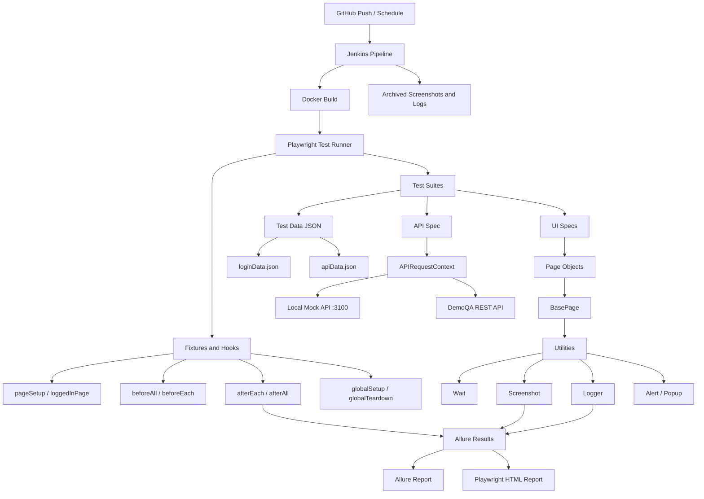

# Framework Architecture

## Architecture diagram

## Layers

| Layer | Responsibility | Key files |
| --- | --- | --- |
| Test Suites | Positive and negative UI/API scenarios | `tests/*.spec.js` |
| Fixtures and Hooks | Browser/page setup, login state, logging, screenshots, teardown | `fixtures/testSetup.js`, `hooks/*.js` |
| Page Objects | Page elements and actions | `pages/*.js` |
| Core | Navigation and retry logic | `pages/BasePage.js` |
| Utilities | Waits, screenshots, logging, dialogs, API validation, booking flow | `utilities/*.js` |
| Test Data | Credentials, endpoints, payloads and expected results | `testdata/*.json` |
| API Layer | Playwright `request` fixture and local mock server | `tests/api.spec.js`, `mock/server.js` |
| Reporting | Allure results, HTML report, screenshots, execution logs | `allure-results/`, `playwright-report/`, `logs/` |
| CI/CD | Container build, test execution, report publishing | `Dockerfile`, `Jenkinsfile` |

## Execution flow

1. Jenkins pulls the repository and builds the Docker image.
2. Playwright starts the local mock API server through `webServer`.
3. `globalSetup` prepares report and log directories.
4. `beforeAll` and `beforeEach` hooks initialize logging and dialog handling.
5. UI specs use page objects and JSON credentials; API specs use `request` and JSON endpoint data.
6. `afterEach` attaches screenshots and failure logs.
7. `afterAll` and `globalTeardown` close the suites.
8. Allure and HTML reports are generated and archived by Jenkins.
